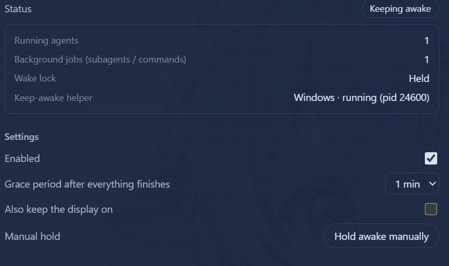

# dsh-keep-awake

<div align="center">

**Keep-awake plugin for the DeepSeek Harness (UI follows the DSH global language)**

Blocks OS sleep while any agent / subagent / background job runs · auto-release after a configurable grace period once idle · manual hold · optional display-on · optional: stay awake while scheduled tasks are pending · Windows / macOS / Linux · persisted settings · multilingual web settings page

[](https://github.com/bearice/dsh-keep-awake)
[](LICENSE)
[](https://github.com/deepseek-ai/deepseek-harness)

**English** | [中文](README.md)

</div>

<div align="center">



</div>

## Features

| Feature | Where | Details |
|---|---|---|
| Live status | Settings → Keep Awake | Status badge (Keeping awake / Grace Ns / Standby / Disabled / Helper error), running agent count, background job count, helper platform + PID |
| Activity detection | — | Running agents (main agent / subagents / workflow children) + running background jobs (`run_in_background` commands / background subagent tasks) |
| Grace period | Configurable | Automatically releases keep-awake 15s–5m (default 60s) after everything finishes |
| Manual hold | Settings page | Force-keep awake regardless of activity; click to release |
| Keep display on | Optional | By default only system sleep is blocked (display may turn off); opt in to keep the display on too |
| Scheduled-task hold | Optional, off by default | While enabled and any scheduled task is pending (status `active`), the wake lock is held so due tasks always fire; released through the grace period once tasks are cleared |
| Localization | Global | Follows the DSH global language (zh/en); auto-detects the browser/system language when unset; switches instantly (including the sidebar label) |

## How it works

Polls every 5 seconds, with instant re-scan on events (`agent/status`, `subagent/start|end`, job set changes):

- **Running agents**: agents with `status === 'running'` in `agents.list()` (covers the main agent, subagents, and workflow children)
- **Background jobs**: `running`/`stopping` jobs from `jobs.list()` (unowned) plus `jobs.list(sessionId)` for every live session (covers `run_in_background` commands and background subagent tasks); job events come from `jobs.events.subscribe({ owners: 'all' }, ...)`
- **Scheduled tasks (optional, off by default)**: with `scheduleHold` enabled, each rescan reads the Host `schedule` service's `catalog()` and counts tasks with `status === 'active'`; any pending task keeps the lock held. `schedule/changed` fires on the schedule service's own context and cordis events only bubble upward, so this plugin cannot subscribe — detection rides the 5 s poll: a newly created task arms the hold within one poll, deletions/pauses release through the grace period within one poll

When activity is detected, a platform helper process is started via the `subprocess` service (tree-level termination — the sleep flags release as soon as the process exits):

| Platform | Mechanism |
|---|---|
| Windows | PowerShell `SetThreadExecutionState(ES_CONTINUOUS \| ES_SYSTEM_REQUIRED)` (adds `ES_DISPLAY_REQUIRED` when "keep display on" is enabled) |
| macOS | `caffeinate [-d] -i -s` |
| Linux | `systemd-inhibit --what=idle --mode=block sleep 1e8` |

## Settings

Changes made on the settings page are written through DSH's `settings` service into the profile's plugin patch (this plugin's own Loader row) and survive a restart:

| Key | Default | Description |
|---|---|---|
| `enabled` | `true` | Master switch |
| `graceMs` | `60000` | Grace period after all activity ends (15s–5m) |
| `preventDisplaySleep` | `false` | Also keep the display on |
| `manualHold` | `false` | Manual hold |
| `scheduleHold` | `false` | Stay awake while scheduled tasks are pending. When enabled the settings page shows the pending count and the next due time; on a host without the `schedule` service the option is inert and the page says so |

All of these fields are marked volatile in `Config`, so a change applies live without remounting the plugin. Every write carries a revision for optimistic concurrency: if two settings pages write at once, the later one gets a 409 and reloads the live values. On a host without a `settings` service (older DSH) the page still works, but changes last only until DSH restarts and the UI says so.

## Compatibility

| Item | Requirement |
|---|---|
| DSH | `>=0.2.0-rc.1 <0.3.0-0` (`engines.dsh`; developed against `0.2.1-rc.2`, `scheduleHold` and the full regression verified against `0.2.1-rc.4`) |
| Node | `>=22` |
| `@deepseek-ai/schemastery` | `~3.18.5` (volatile fields need `.volatile()`, added in 3.18.5; same range the host bundles) |

`dsh.compatibility.dshReleases` declares the releases actually verified: `0.2.1-rc.2` and `0.2.1-rc.4`. `scheduleHold` relies on the Host's `schedule` service (bundled with every 0.2-line host); on a host without it the option degrades to a no-op and the settings page says so.

## Localization

The UI uses the framework `locale` service (this plugin's locale namespace is `keep-awake`, zh/en dictionaries): when no language is explicitly set, the browser/system language is used; switching in DSH's language settings takes effect instantly (both the settings page body and the sidebar label follow).

## HTTP routes (loopback)

- `GET /dsh-keep-awake/state` — current state (activity counts, schedule-hold view (`pendingSchedules` / `nextDueAt` / `scheduleService`), helper process, config, plus `revision` and `persistent`)
- `PUT /dsh-keep-awake/config` — update config, body `{ "section": {...}, "revision": <optional> }`; a stale revision returns `409` with the live state, an unknown key returns `400`

## Install

```sh
# Inside the profile directory (e.g. ~/.dsh/profiles/web)
pnpm add "dsh-keep-awake@<source>"   # npm / github:bearice/dsh-keep-awake / link:<local path>
# and add "dsh-keep-awake" to dsh.profile.bundles in package.json
pnpm install
# restart the profile
```

## Development

- For local development, mount the package into the profile via `link:` (see Install above) and use `node --check lib/*.js` for syntax checks
- Layout: `lib/index.js` (Host), `lib/client.js` (web settings page), `cordis.patch.yml` (mount line)
