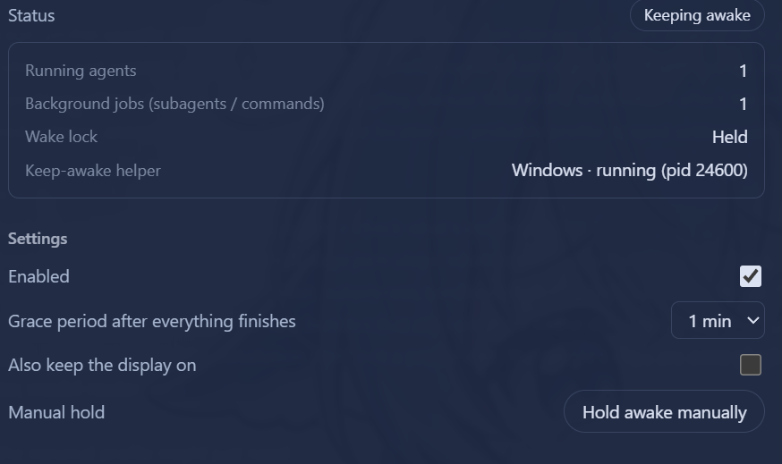

# dsh-keep-awake

<div align="center">

**DeepSeek Harness 防休眠插件（界面跟随 DSH 全局语言）**

任意 agent / subagent / 后台任务运行时阻止系统休眠 · 全部空闲后按宽限期自动释放 · 手动保持唤醒 · 可选阻止屏幕关闭 · Windows / macOS / Linux · 设置持久化 · 多语言 Web 设置页

[](https://github.com/bearice/dsh-keep-awake)
[](LICENSE)
[](https://github.com/deepseek-ai/deepseek-harness)

[English](README.en.md) | **中文**

</div>

<div align="center">



</div>

## 功能总览

| 功能 | 位置 | 说明 |
|---|---|---|
| 实时状态 | 设置页「防休眠」 | 状态徽章（保持唤醒中 / 宽限中 Ns / 待机 / 已停用 / 助手异常）、运行中 agent 数、后台任务数、辅助进程平台 + PID |
| 活动判定 | — | 运行中的 agent（主 agent / subagent / workflow 子代理）+ 运行中的后台任务（`run_in_background` 命令 / 后台 subagent 任务） |
| 宽限期 | 设置页可配 | 全部活动结束后 15s–5m（默认 60s）自动释放防休眠 |
| 手动保持 | 设置页 | 无视活动状态强制保持唤醒，点击取消 |
| 阻止屏幕关闭 | 设置页可选 | 默认只防系统休眠、允许熄屏；勾选后屏幕也保持 |
| 多语言 | 全局 | 跟随 DSH 全局语言（zh/en），未显式设置时跟随浏览器/系统，切换即时生效（含侧边栏标签） |

## 工作原理

每 5 秒轮询 + 事件即时重扫（`agent/status`、`subagent/start|end`、job 集变更）：

- **运行中的 agent**：`agents.list()` 中 `status === 'running'` 的 agent（覆盖主 agent、subagent、workflow 子代理）
- **后台任务**：`jobs.list()`（无归属任务）加上对每个活跃会话的 `jobs.list(sessionId)`，统计 `running`/`stopping` 的任务（覆盖 `run_in_background` 命令与后台 subagent 任务）；任务事件来自 `jobs.events.subscribe({ owners: 'all' }, ...)`

检测到活动时通过 `subprocess` 服务启动一个平台辅助进程（树级终止，进程退出即释放休眠标志）：

| 平台 | 机制 |
|---|---|
| Windows | PowerShell `SetThreadExecutionState(ES_CONTINUOUS \| ES_SYSTEM_REQUIRED)`（勾选“同时阻止屏幕关闭”时加 `ES_DISPLAY_REQUIRED`） |
| macOS | `caffeinate [-d] -i -s` |
| Linux | `systemd-inhibit --what=idle --mode=block sleep 1e8` |

## 设置

设置页的改动通过 DSH 的 `settings` 服务写入 profile 的插件补丁（本插件自己的 Loader 行），重启后保留：

| 键 | 默认 | 说明 |
|---|---|---|
| `enabled` | `true` | 总开关 |
| `graceMs` | `60000` | 全部活动结束后的宽限期（15s–5m） |
| `preventDisplaySleep` | `false` | 同时阻止屏幕关闭 |
| `manualHold` | `false` | 手动保持唤醒 |

这些字段在 `Config` 中都标记为 volatile，因此改动即时生效、不会重挂插件；每次修改都带修订号做乐观并发，两个设置页同时改时后改的一方会收到 409 并自动刷新为最新值。宿主没有 `settings` 服务时（例如老版本 DSH）设置页仍可操作，但改动只在本次运行内生效，界面会显示相应提示。

## 兼容性

| 项目 | 要求 |
|---|---|
| DSH | `>=0.2.0-rc.1 <0.3.0-0`（`engines.dsh`；开发验证于 `0.2.1-rc.2`） |
| Node | `>=22` |
| `@deepseek-ai/schemastery` | `~3.18.5`（volatile 字段需要 3.18.5 起的 `.volatile()`，与宿主捆绑版本一致） |

`dsh.compatibility.dshReleases` 目前只声明了实际验证过的 `0.2.1-rc.2`。

## 多语言

界面使用框架 `locale` 服务（本插件的语言 namespace 为 `keep-awake`，zh/en 字典）：未显式设置语言时自动跟随浏览器/系统语言；在 DSH 语言设置中切换后即时生效（设置页正文与侧边栏标签均跟随）。

## HTTP 路由（loopback）

- `GET /dsh-keep-awake/state` — 当前状态（活动计数、助手进程、配置，含 `revision` 与 `persistent`）
- `PUT /dsh-keep-awake/config` — 更新配置，body `{ "section": {...}, "revision": <可选> }`；修订号过期返回 `409` 并附最新状态、未知键返回 `400`

## 安装

```sh
# 在 profile 目录内（如 ~/.dsh/profiles/web）
pnpm add "dsh-keep-awake@<来源>"   # npm / github:bearice/dsh-keep-awake / link:<本地路径>
# 并把 "dsh-keep-awake" 加入 package.json 的 dsh.profile.bundles
pnpm install
# 重启 profile
```

## 开发

- 本地开发建议以 `link:` 方式挂入 profile（见上方安装步骤），`node --check lib/*.js` 做语法校验
- 包结构：`lib/index.js`（Host）、`lib/client.js`（Web 设置页）、`cordis.patch.yml`（挂载行）
